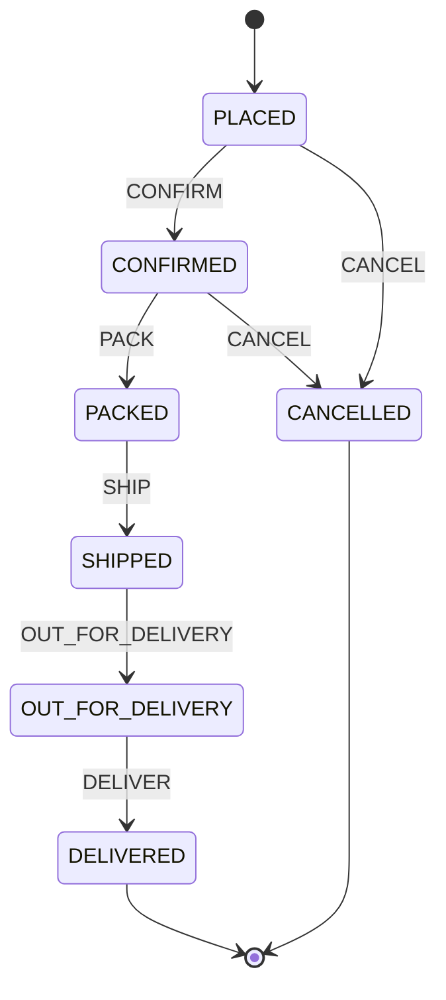

# DFA Design — Order Status Validation

## Formal definition
A DFA is a 5-tuple **M = (Q, Σ, δ, q₀, F)**.

- **Q (states):** {PLACED, CONFIRMED, PACKED, SHIPPED, OUT_FOR_DELIVERY, DELIVERED, CANCELLED}
- **Σ (input alphabet):** {CONFIRM, PACK, SHIP, OUT_FOR_DELIVERY, DELIVER, CANCEL}
- **q₀ (initial state):** PLACED
- **F (final/accepting states):** {DELIVERED, CANCELLED}
- **δ (transition function):** defined by the table below. Any missing transition is invalid and rejected.

## State transition diagram

## Transition table

| Current state | Input / event | Next state | Valid? |
|---|---|---|---|
| PLACED | CONFIRM | CONFIRMED | Yes |
| PLACED | CANCEL | CANCELLED | Yes |
| CONFIRMED | PACK | PACKED | Yes |
| CONFIRMED | CANCEL | CANCELLED | Yes |
| PACKED | SHIP | SHIPPED | Yes |
| SHIPPED | OUT_FOR_DELIVERY | OUT_FOR_DELIVERY | Yes |
| OUT_FOR_DELIVERY | DELIVER | DELIVERED | Yes |
| DELIVERED | Any event | — | No |
| CANCELLED | Any event | — | No |
| Any state | Unlisted event | — | No |

## Validation examples
- `PLACED → CONFIRMED → PACKED → SHIPPED` — accepted prefix; order is in progress.
- `PLACED → CANCELLED` — accepted terminal path.
- `PLACED → SHIPPED` — rejected because the transition is not defined.
- `DELIVERED → PACKED` — rejected because DELIVERED is terminal.

The backend function `server/src/utils/orderDfa.js` is the executable transition function used by the status API. The frontend displays the current state but the backend is the authority.
